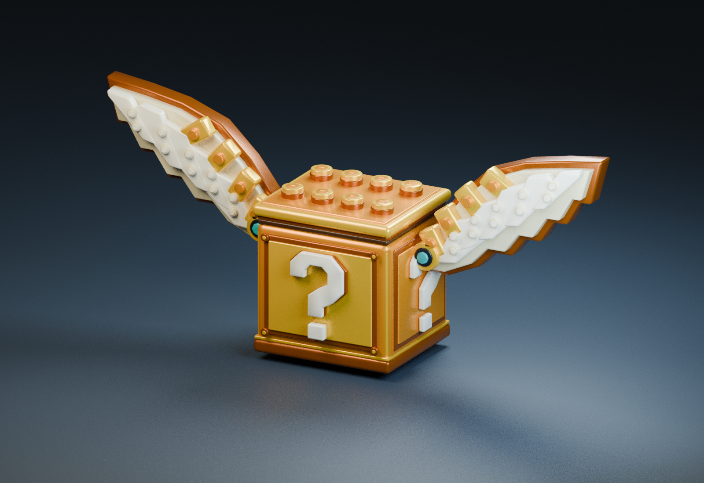

# Skybrick Lucky Block для Roblox

Золотой лаки-блок в стиле конструктора: восемь шипов на крышке,
выпуклые знаки вопроса и объёмные крылья со ступенчатыми перьями.

**[Скачать весь комплект ZIP](https://github.com/xXxDARKFOXxXx/govnoroblox/raw/refs/heads/main/downloads/Skybrick_Lucky_Block_Complete.zip)**

В комплект входят:

- [FBX для импорта](models/skybrick/Skybrick_Lucky_Block.fbx) и [GLB](models/skybrick/Skybrick_Lucky_Block.glb).
- [Редактируемый исходник Blender](models/skybrick/Skybrick_Lucky_Block.blend).
- [Текстура](models/skybrick/Skybrick_Atlas.png) и [скрипт генерации модели](models/skybrick/build_lucky_block.py).
- [Анимация открытия в TXT](models/skybrick/Roblox_Opening_Animation.txt).
- [Подробная инструкция на русском](models/skybrick/README_RU.txt).

## Установка

1. Импортируйте FBX через Import 3D в Roblox Studio, сохранив четыре отдельные
   части `Body`, `Lid`, `WingL`, `WingR` внутри общей `Model` в `Workspace`.
2. Создайте внутри этой модели обычный серверный `Script` и вставьте всё
   содержимое `Roblox_Opening_Animation.txt`.
3. Нажмите Play, подойдите к блоку и удержите **E**.

Скрипт добавляет парение, взмах крыльев, подъём крышки, искры, вспышку,
расходящееся световое кольцо и конфетти из маленьких кирпичиков.
Затем блок закрывается и снова доступен для открытия. Награды и звук
не включены; серверное событие `Opened` позволяет подключить свою логику.

## Проверки

FBX и GLB проверены обратным импортом в Blender 4.3.2: четыре сетки,
доступная текстура, корректные UV и симметрия крыльев. В исходнике Blender
проверены открытие крышки, подъём крыльев и возврат в исходное положение.

Roblox Studio здесь не запускался. Проверку импорта, эффектов, управления
и работы с несколькими игроками необходимо выполнить в Studio.
Подробности: [VALIDATION.txt](models/skybrick/VALIDATION.txt).
