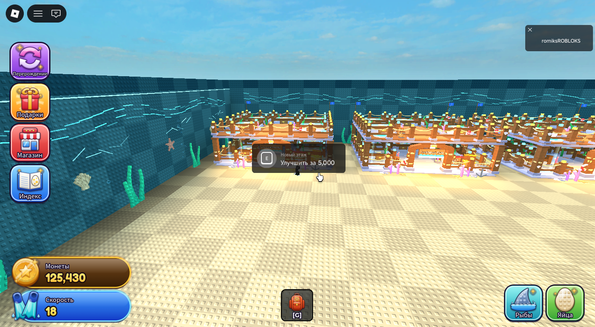
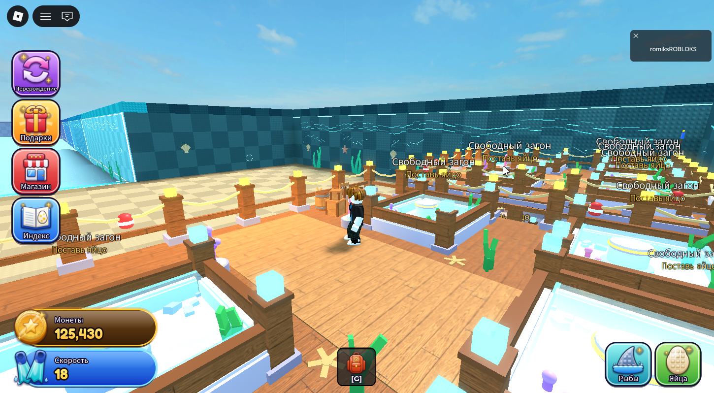

# OceanBases — базы игроков



На стартовой площадке стоят 5 баз — компактные морские питомники вдоль задней стены.
Они занимают **22 % площадки**, центр и проход к океану свободны под будущие постройки.
База растёт **вверх**: на каждом этаже 5 загонов.

| Уровень | Этажи | Загоны | Цена |
|---|---|---|---|
| Старт | 2 | 10 | — |
| Улучшение 1 | 3 | 15 | 5,000 монет |
| Улучшение 2 | 4 | 20 | 25,000 монет |



## Как запустить

Открой **`brain rot/OceanGame.rbxl`** — это карта, HUD и базы в одном файле — и нажми **Play (F5)**.
Базы видны и в режиме редактирования.

В Studio у игрока есть тестовые монеты (125,430) и яйца всех видов. Как поиграть:

1. Ты появляешься у входа в свою базу. Над входом табличка «База: <имя>».
2. Подойди к свободному загону и зажми **E** («Поставить яйцо»).
   Ставится яйцо, выбранное в хотбаре (клавиши 1–8). Если там не яйцо, берётся любое яйцо из инвентаря.
3. Над загоном идёт обратный отсчёт. Потом из яйца появляется рыба и начинает плавать.
4. Рыба приносит монеты в **сундук** у входа: зажми **E** у сундука, чтобы их забрать.
5. **Табло «Улучшение базы»** справа от входа добавляет новый этаж.
   Между этажами ездит **пузырьковый лифт** в левом переднем углу: **E** — вверх, **F** — вниз.

Подсказки загонов, сундука и улучшения видит только владелец базы. Права проверяет сервер,
поэтому чужие яйца поставить и чужие монеты собрать нельзя.

## Яйца и рыбы

| Яйцо | Вылупляется | Рыбы (шанс) |
|---|---|---|
| Обычное яйцо | 15 с | Рыба-клоун 70 %, Синий хирург 30 % |
| Звёздное яйцо | 30 с | Синий хирург 40 %, Рыба-фугу 45 %, Удильщик 15 % |
| Морское яйцо | 45 с | Рыба-фугу 40 %, Удильщик 50 %, Королевская рыбка 10 % |
| Золотое яйцо | 60 с | Удильщик 40 %, Королевская рыбка 60 % |

Доход рыб: клоун 3, хирург 6, фугу 12, удильщик 30, королевская 75 монет в секунду.
Все цифры меняются в `src/shared/BaseConfig.luau`.

## Как устроена база

Каждая база — модель `BaseN` с `PrimaryPart = Root`, её можно двигать целиком через `PivotTo`.

```
Workspace.OceanBases.BaseN
  Root, SpawnPoint
  Floors/FloorK  (FloorRoot, Slab, Columns, Fence, Pens, Lift, Decor)
  Entrance (арка, табличка владельца), Chest, UpgradeBoard, Decor
ServerStorage.OceanBasesLocked.BaseN/Floor3, Floor4   — этажи до покупки
```

Каждый загон — отдельная модель `FishPenX` из частей
`Base`, `Walls`, `Water`, `Decorations`, `EggPlacement` (с `FishSpawn`), `FishMovementArea`,
`InteractionPoint` (подсказка и `IncomeDisplay`), `Effects` и `Content` (яйцо или рыба).

| Файл | Где в игре | Что делает |
|---|---|---|
| `src/shared/BaseConfig.luau` | ReplicatedStorage.OceanBases | размеры, палитра, расстановка, яйца, рыбы, цены |
| `src/server/BasePieces.luau` | ServerScriptService.OceanBases | детали и морской декор: водоросли, кораллы, ракушки, фонари, канаты, сети, бочки, якорь, круг, буйки, флаги, кристаллы |
| `src/server/FishPenBuilder.luau` | ″ | загон: камень, доски, столбы с подсветкой, вода, пьедестал, декор, табличка, пузыри |
| `src/server/BaseBuilder.luau` | ″ | база: платформа, этажи, колонны, забор, арка, сундук, табло, лифт |
| `src/server/CreatureModels.luau` | ″ | модели яиц и рыб |
| `src/server/BaseOwnershipService.luau` | ″ | выдача баз игрокам, появление на базе, освобождение |
| `src/server/FishPenController.luau` | ″ | яйца, вылупление, доход, сундук |
| `src/server/BaseUpgradeService.luau` | ″ | новые этажи и лифт |
| `src/server/OceanBases.server.luau` | ″ | запуск; если баз нет в Workspace, строит их сам |
| `src/client/OceanBasesClient.client.luau` | StarterPlayerScripts | подсказки только для владельца, связь хотбара с сервером |
| `src/client/FishAnimationController.luau` | ″ | плавание рыб, хвосты, круги на воде, покачивание яиц |
| `src/client/BaseVisualEffects.luau` | ″ | мерцание воды и подсветки (15 раз в секунду, только рядом с камерой) |

**Производительность:**
- Все детали закреплены (Anchored), у мелкого декора коллизия отключена.
- Настоящих источников света 4 на базу.
- Каждая анимация — один общий цикл, анимируются только объекты рядом с камерой.
- На базу приходится около 1,700 деталей.

## Сборка и проверка

Сначала собери HUD (`brain rot/OceanHUD`, см. его README), затем из папки `brain rot/OceanBases`:

```powershell
..\..\tools\lune\lune.exe run tools/check.luau
..\..\tools\lune\lune.exe run tools/build.luau
```

`check.luau` прогоняет 84 офлайн-проверки на настоящих скриптах:
- раскладка: базы внутри площадки, не касаются друг друга, спереди свободно 105+ studs;
- структура загонов;
- выдача баз, яйца из инвентаря, запрет чужих действий, вылупление, доход, сбор;
- улучшения до 20 загонов, лифт, освобождение базы;
- модели всех яиц и рыб, анимация плавания.

`build.luau` запекает базы в `brain rot/OceanGame.rbxl`.
`tools/render_preview.py` рисует офлайн-превью геометрии (это не скриншот Studio).

Проверено в Studio: базы стоят на площадке, игрок появляется на своей базе, подсказки и надписи работают.
Полный игровой цикл (поставить яйцо → рыба → сундук → этаж) проверен офлайн-тестами, вручную в Studio его ещё нужно пройти.

**Пока не сделано:**
- сохранение баз между сессиями (DataStore);
- поиск яиц в океане: сейчас яйца берутся из инвентаря;
- возможность забрать рыбу из загона.
