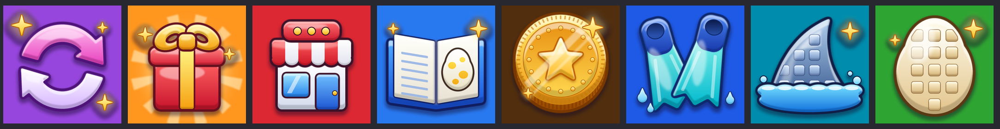

# OceanHUD v3.2 — интерфейс игры



Слева четыре кнопки: **Перерождение**, **Подарки**, **Магазин** и **Индекс**.
Внизу слева монеты и скорость (иконка — ласты; число показывает, сколько скорости прокачано).
Внизу справа кнопки **Рыбы** (плавник акулы) и **Яйца**: они открывают окна с рыбами и яйцами игрока.
Все иконки — PNG-картинки с прозрачным фоном, показанные через `ImageLabel`.

## Быстрый запуск в Studio

1. Один раз выполни `tools\install-studio-textures.ps1`. Скрипт копирует иконки в папку Studio,
   чтобы они показывались без загрузки на Roblox.
2. Открой **OceanMap-with-HUD.rbxl** и нажми **Play (F5)**.
   В Studio скрипт `OceanHUDTestData` сразу выставляет тестовые значения:
   монеты 125,430, скорость 18.

Чтобы посмотреть анимации, во время игры выполни в **Command Bar** (переключатель Server):

```lua
local S = require(game.ServerScriptService.OceanHUDStats)
local p = game.Players:GetPlayers()[1]
S.addCoins(p, 5000)  S.addSpeed(p, 1)
```

## Иконки для опубликованной игры (обязательно)

Путь `rbxasset://textures/OceanHUD/...` работает **только в Studio на этом компьютере**.
Чтобы иконки увидели другие игроки:

1. В Studio открой **Window → Asset Manager → Bulk Import** и загрузи все PNG из папки `assets`:
   `Rebirth`, `Gifts`, `Shop`, `Index`, `Coin`, `Flippers`, `SharkFin`, `Egg`, `Sparkle`.
2. Скопируй ID каждой картинки и вставь его в `src/modules/UIAssets.luau` → `UIAssets.Uploaded`,
   например `Coin = "rbxassetid://1234567890"`.
3. Пересобери проект (см. ниже).

Выдуманные ID в коде не используются: пока поле пустое, берётся локальная картинка.
После обновления Studio ещё раз запусти `install-studio-textures.ps1`: у новой версии Studio своя папка.

## Как устроено

| Файл | Где в игре | Что делает |
|---|---|---|
| `src/OceanHUD.client.luau` | StarterPlayerScripts → **OceanHUD** (LocalScript) | HUDController: создаёт интерфейс один раз, раскладку и связь с данными |
| `src/modules/UITheme.luau` | модуль внутри OceanHUD | цвета, размеры для экрана 1648×928, длительности анимаций |
| `src/modules/UIAssets.luau` | модуль | все картинки и звук клика в одном месте |
| `src/modules/UIComponents.luau` | модуль | объёмные плашки: тень, нижняя грань, градиент, блик, обводки |
| `src/modules/UIAnimations.luau` | модуль | TweenService: наведение, нажатие, «подпрыгивание», вспышка, покачивание |
| `src/modules/UIDataController.luau` | модуль | читает данные игрока и сообщает об изменениях |
| `src/modules/MenuController.luau` | модуль | окна меню: появление через Scale + Fade, одно окно за раз |
| `src/server/OceanHUDStats.luau` | ServerScriptService → **OceanHUDStats** | серверные методы `setCoins`, `addCoins`, `setSpeed`, `addSpeed` |
| `src/server/OceanHUDTestData.server.luau` | ServerScriptService | тестовые значения, работает **только в Studio** |
| `tools/draw_icons.py` | — | рисует иконки в `assets` (Python + Pillow) |

**Данные.** Сервер записывает атрибуты игрока: `Coins` и `SpeedLevel` (прокачанная скорость, просто число).
Если атрибута нет, используются одноимённые значения из `leaderstats`.
Клиент ничего не начисляет, он только показывает данные.

**Анимации.**
- Кнопки: при наведении увеличиваются на 7 % и подсвечиваются (0,17 с), при нажатии сжимаются до 93 % и проигрывают звук.
- Монеты: число плавно досчитывается до нового значения, монета подпрыгивает и вспыхивает.
- Скорость: при повышении текст увеличивается, ласты покачиваются.

Постоянных циклов нет: анимации запускаются только при изменениях. При удалении интерфейса все соединения отключаются.

**Меню.** Повторное нажатие той же кнопки закрывает меню. Закрыть можно также крестиком, кликом по фону или клавишей Esc.
Окна есть и у кнопок **Рыбы** (`FishMenu`) и **Яйца** (`EggsMenu`). Своё содержимое добавляй в `ScrollingFrame` **Content**:
`PlayerGui.OceanHUD.SafeArea.MenuBackdrop.ShopMenu.Panel.Body.Content`.
Чтобы открывать свои окна вместо встроенных, задай атрибут `UseExternalMenus = true` у `PlayerGui.OceanHUD`
и слушай событие `OpenMenu` (приходит `"Rebirth"`, `"Gifts"`, `"Shop"`, `"Index"`, `"Fish"` или `"Eggs"`).

**Экран.** Размеры заданы для 1648×928 и масштабируются под размер экрана с учётом безопасной зоны Roblox.
На узких экранах счётчики и кнопки «Рыбы»/«Яйца» уменьшаются, чтобы поместиться рядом. Элементы не перекрывают друг друга:
это проверено на 10 размерах, от 360×580 до 1920×1140.

## Сборка и проверка

Из папки `brain rot\OceanHUD`:

```powershell
python tools/draw_icons.py assets
..\..\tools\lune\lune.exe run tools/check.luau
..\..\tools\lune\lune.exe run tools/build.luau
.\tools\install-studio-textures.ps1
```

`build.luau` создаёт `OceanHUD.rbxmx` (клиентский LocalScript с модулями), `OceanHUD-Server.rbxmx`
(серверные скрипты) и `OceanMap-with-HUD.rbxl` — копию `OceanMap-v4` с интерфейсом. Сами файлы OceanMap не меняются.
`check.luau` прогоняет 92 офлайн-проверки: данные, анимации, меню, раскладку и серверный модуль.
Версия 3.0 проверена вживую в Roblox Studio; изменения 3.1–3.2 проверены офлайн-тестами.

Чтобы встроить интерфейс в другой плейс: вставь `OceanHUD.rbxmx` в **StarterPlayerScripts**,
а `OceanHUD-Server.rbxmx` — в **ServerScriptService** (через **Insert from File…**).
