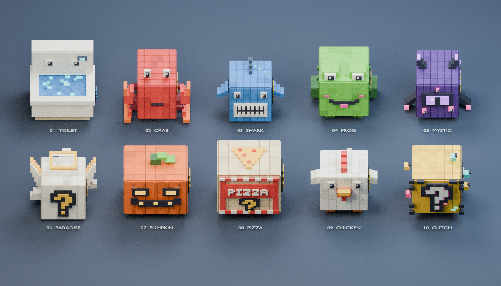

# CUBIC LUCKY — 10 блоков, исправленная версия v2



**[Скачать исправленный комплект v2 ZIP](https://github.com/xXxDARKFOXxXx/govnoroblox/raw/refs/heads/main/downloads/Cubic_Lucky_Blocks_10_v2.zip)**

В первой версии часть граней была направлена внутрь. Blender рисовал обе
стороны и скрывал дефект, а Roblox отбрасывал обратные стороны — появлялись
«дыры». В v2 исправлен порядок вершин всех граней и убран пересчёт нормалей
для разрозненных полигонов. Это исправление самих сеток, а не включение DoubleSided.

**Для обновления нужно заново импортировать меши:** останови Play, замени
старые экземпляры файлами **`LB_*_v2.fbx`** или **`LB_*_v2.glb`** и установи
анимацию на новые модели. Одна замена TXT не исправит старые MeshId.
При импорте сохрани отдельные компоненты. Старые файлы без `_v2` из этой
папки удалены, чтобы их нельзя было выбрать по ошибке.

У райского блока корпус расширен на **36,7%** (примерно с 2,04 до 2,79 studs),
расширен и нимб; корпус теперь близок к кубу.
Общий размер модели остался прежним. Измерения: `paradise_width_change.json`.

У всех моделей общий габарит геометрии: **4 × 3,8 × 3,4 studs** в Roblox.
Размер задан по всей модели, включая лапы, клешни, плавники, крылья и нимб.
Парение добавляет до 0,45 studs к положению над землёй. Установщик нормализует
масштаб до 4 studs по самой длинной стороне и сохраняет уровень нижней точки.

Все поверхности — плоские прямоугольные грани. Детали, надписи и знаки вопроса
собраны из кубиков. Нет цилиндров, сфер, скруглений, сглаживания и открывающихся
крышек. У пиццы закрытый фиксированный корпус, у унитаза открытая квадратная чаша.

| № | Модель | Детали и движение | Цвета эффектов |
| --- | --- | --- | --- |
| 01 | [Унитаз](01_Toilet/Preview.png) | Квадратная чаша с водой, бачок с глазами, кубические пузырьки | Голубой, белый |
| 02 | [Краб](02_Crab/Preview.png) | Шесть ступенчатых лап, клешни, глаза на стебельках | Коралловый, песочно-жёлтый |
| 03 | [Акула](03_Shark/Preview.png) | Парение, боковые плавники, хвост, кубические зубы и жабры | Синий, бирюзовый |
| 04 | [Лягушка](04_Frog/Preview.png) | Лапы с пальцами, большие глаза, лёгкое подпрыгивание | Зелёный, жёлтый |
| 05 | [Мистический](05_Mystic/Preview.png) | Парение, глаза, рога, тёмные отростки, светящиеся вставки | Фиолетовый, розовый |
| 06 | [Райский](06_Paradise/Preview.png) | Парение, крылья, квадратный нимб, три летающих облака | Золотой, ледяной белый |
| 07 | [Тыква](07_Pumpkin/Preview.png) | Корни-лапы, зелёный стебель, светящиеся глаза и зубы | Оранжевый, кислотно-зелёный |
| 08 | [Пицца](08_Pizza/Preview.png) | Коробчатый корпус, PIZZA из пикселей, сыр и квадратная пепперони | Сырный жёлтый, красный |
| 09 | [Курица](09_Chicken/Preview.png) | Лапы, клюв, гребень, небольшие крылья, хвост | Жёлтый, оранжевый |
| 10 | [Glitch](10_Glitch/Preview.png) | Парение, разнесённые пиксели, RGB-смещения вокруг «?» | Золотой, розовый, бирюзовый |

## Установка в Roblox Studio

1. Распакуй ZIP. Для каждого блока выбери его **FBX** через Import 3D.
   GLB приложен как альтернатива. Сохрани отдельные компоненты и вставь
   каждый блок своей общей `Model`. Не объединяй 10 блоков в одну MeshPart.
2. Останови Play. В Explorer выдели одну или несколько полных моделей блоков.
3. Открой [Install_CommandBar.txt](Install_CommandBar.txt), скопируй **всё**
   содержимое в **Command Bar** Roblox Studio и выполни.
   Это установщик для редактора; не вставляй его в обычный Script.
4. Он выставит размер, определит вариант по `Body_<название>`, создаст
   серверный `Cubic_Opening` внутри каждого блока и отключит распознанные
   старые анимации. Другие игровые скрипты он сохраняет.
5. Запусти **Play / F5**, подойди к корпусу и удержи **E**.
   На телефоне — экранная кнопка, на геймпаде — X.

Если выделена общая модель с десятью вложенными моделями, установщик также
обработает их по отдельности. Для повторной установки снова останови Play.
Не ставь сюда прежнюю анимацию Skybrick с обязательной `Lid`.

Сам `Cubic_Opening.txt` можно вставить вручную в обычный включённый Script
с `RunContext = Server` внутри каждой модели в Workspace. При таком способе
масштаб придётся настроить самостоятельно до запуска. Имена вроде
`Body_Crab_Mesh.001` распознаются; менять имена компонентов не требуется.

## Как открывается блок

В ожидании работают движения варианта и редкие тематические кубические
частицы. При открытии весь блок трясётся и пульсирует вместе с деталями.
Восемь светящихся кубиков со шлейфами ускоряются вокруг него, появляются
квадратные ударные волны и нарастает свет. Через 3,25 секунды — кубическая
вспышка, две большие квадратные волны и разлёт 44 мелких фрагментов.
**Весь блок исчезает, включая крылья, лапы и облака. Крышка не отделяется.**

Взрыв декоративный: нет Roblox `Explosion`, урона, физического толчка или
коллизий у фрагментов. Для повторного открытия по умолчанию блок возвращается
через 35 секунд. Поставь `RespawnSeconds = 0` для одноразового варианта.

Голубые пузырьки, песочные крошки, фиолетовые огоньки, цифровые осколки
и световые волны реализованы геометрическими частицами из маленьких Parts.
**Они не требуют загрузки текстур, HTTP-запросов или платных ассетов.**
Дополнительно приложен `Pixel_Particle.png`: если нужен обычный ParticleEmitter,
загрузи его как своё изображение и добавь к Model строковый атрибут
`ParticleTexture = rbxassetid://ТВОЙ_ID`. Он добавится к геометрическим эффектам.

## Текстуры и Blender

`Voxel_Atlas.png` — общая пиксельная текстура 1024 × 1024. Она встроена
в FBX/GLB и упакована в .blend. Геометрический рельеф сохраняется при импорте.
Если Studio не подхватит изображение из FBX, загрузи atlas один раз и назначь
его asset ID в `TextureID` MeshPart или `ColorMap` используемого SurfaceAppearance.
Цвет MeshPart должен быть белым; установщик уже выставляет его.
Светящиеся компоненты `Glow_*` скрипт переводит в Neon.

У каждого блока своя папка с FBX, GLB, .blend, `Preview.png` и статистикой.
`Cubic_Collection.blend` — общая сцена с десятью моделями и подписями.
Объекты `STUDIO_*` — только презентационные; их нет в FBX/GLB.
Blender-файлы показывают геометрию; игровое парение, частицы и открытие
выполняет Luau в Studio, а не таймлайн Blender.

Для генерации всех файлов в новом процессе Blender 4.3+:

```sh
blender -b -t 6 --python build_collection.py -- /полный/путь/к/новой/папке
```

Скрипт очищает сцену. `--no-render` пропускает рендеры.
`--only=Toilet,Paradise` обновляет выбранные модели в уже собранной папке.
После редактирования общего Luau пересобери установщик:

```sh
python build_installer.py
```

Проверка экспортов с отсечением обратной стороны:

```sh
blender -b --python validate_exports.py -- /полный/путь/к/комплекту
```

Она сравнивает направление внешних граней с эталонными объёмами кубиков
из `*/solid_contract.json`, проверяет обе стороны нормали и повторяет
проверки размеров/текстур. Рендеры v2 также скрывают обратные стороны.

## Настройки и награды

Параметры находятся в начале `Cubic_Opening` внутри модели:

- `ChargeTime = 3.25` — длительность зарядки.
- `RespawnSeconds = 35` — задержка возврата; 0 — без возврата.
- `ParticleMultiplier = 1` — количество геометрических частиц; например, 0.5.
- `RewardsEnabled = true` — выдача награды; false оставляет только эффекты.
- `CoinsMin = 25`, `CoinsMax = 150` — запасная награда в `LuckyCoins`.
- `PromptDistance = 11` — минимальная дистанция до кнопки.

Можно положить Tool в `ServerStorage/LuckyBlockRewards`. Для отдельных
вариантов создай там папки `Crab`, `Shark` и т. д. Если предметов нет,
выдаются `leaderstats.LuckyCoins`. Сохранение валюты между сессиями
и правила экономики игры в этот комплект не входят.

## Если E не появляется

В Output ожидается `[Cubic] INSTALLED` после установки и `[Cubic] READY`
после Play. У модели есть атрибут `CubicStatus` с этапом или текстом ошибки.
Проверь, что используешь Play с персонажем, а не Run без персонажа,
что модель находится в Workspace и включён серверный Script.
Сообщение `ProximityPromptService.Enabled=false` означает, что подсказки
отключены глобально в игре. При ошибке определения варианта проверь,
что не переименована сетка `Body_<вариант>`, либо задай атрибут `LuckyPreset`.

Экспорт проверен в Blender, Luau — компиляцией и сценариями с тестовыми
объектами Roblox. Сам Roblox Studio здесь не запускался. Проверку вида
текстур, всех движений/эффектов, кнопки E и сетевого режима нужно выполнить
в Studio. Конкретные результаты — в `VALIDATION.md` и `geometry_validation.json`.
